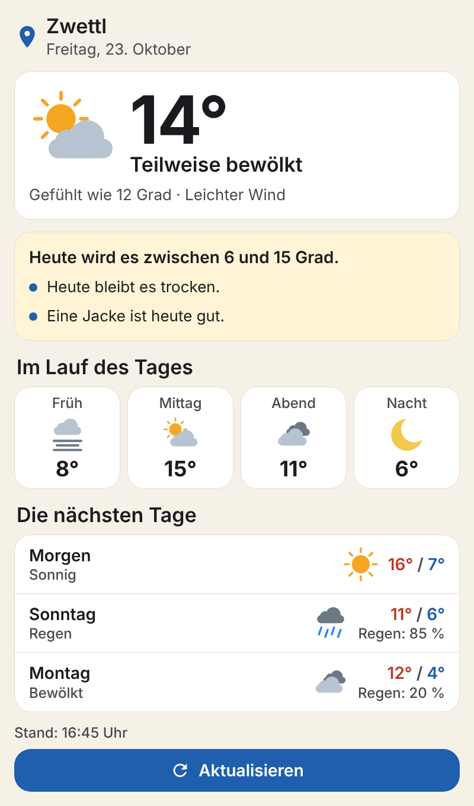
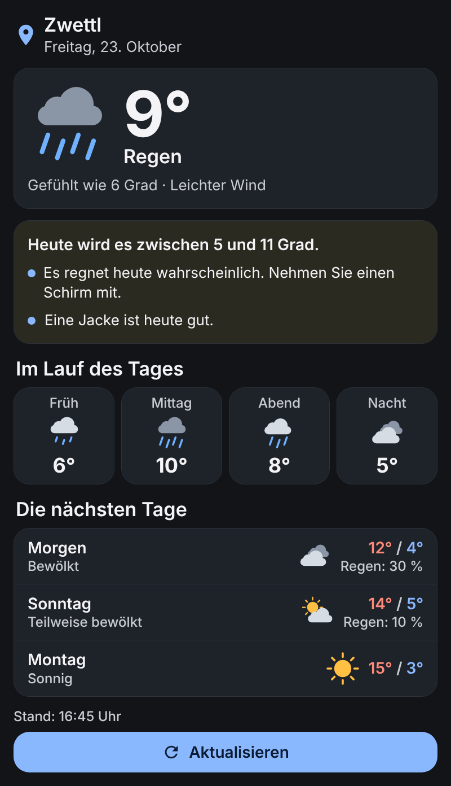
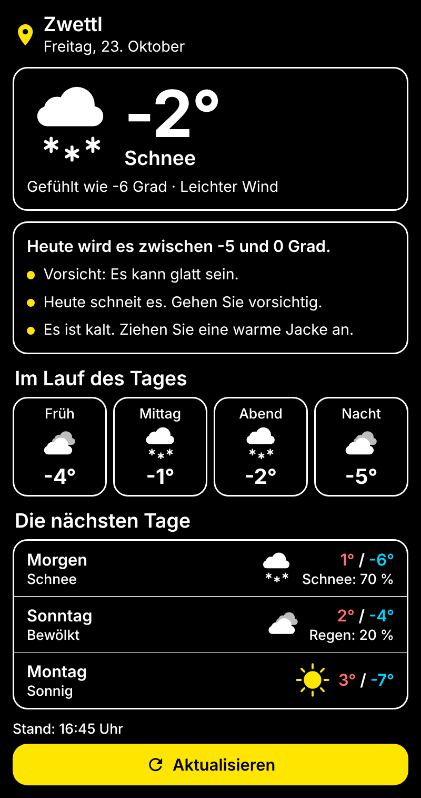

# Sepp-Weather ☀️

Große, klare Wetteranzeige für Android – gemacht für Pensionistinnen und Pensionisten.
Geschrieben in **Kotlin + Jetpack Compose**, als eigenständiges Library-Modul, das sich in **jede Android-App** einbauen lässt.

- **Groß & klar:** Temperatur in 112 sp, Texte ab 24 sp, Knöpfe mindestens 72 dp hoch
- **Ganze Sätze statt Fachbegriffe:** „Es regnet heute wahrscheinlich. Nehmen Sie einen Schirm mit.“
- **Standort des Tablets** – freundliche Erklärung, Freigabe per großem Knopf, Weg zu den Einstellungen, wenn gesperrt
- **Schnell:** zeigt sofort das zuletzt geladene Wetter, aktualisiert im Hintergrund; keine Bilddateien (Symbole werden gezeichnet), keine Netzwerk-Bibliothek
- **Kostenlos:** Wetterdaten von [Open-Meteo](https://open-meteo.com) – kein API-Schlüssel nötig
- **Ohne Google-Play-Dienste:** nutzt den eingebauten Standortdienst von Android
- **Schriftart der App wird automatisch übernommen**
- **Komplett anpassbar:** Farben, Schrift, Schriftgröße, Ecken, Abstände, angezeigte Bereiche
- **Hell, Dunkel, Hoher Kontrast** – plus „Farben der App übernehmen“
- **Tablet quer:** ab 720 dp Breite automatisch zweispaltig
- Bedienhilfe (TalkBack) liest ganze Sätze vor

| Hell | Dunkel | Hoher Kontrast |
|---|---|---|
|  |  |  |

Alle Varianten: [`docs/screenshots/`](docs/screenshots)

---

## 1. Einbinden

### Variante A – Modul kopieren (am einfachsten)

1. Den Ordner `sepp-weather/` in das eigene Projekt kopieren.
2. In `settings.gradle.kts`:
   ```kotlin
   include(":sepp-weather")
   ```
3. In `app/build.gradle.kts`:
   ```kotlin
   dependencies {
       implementation(project(":sepp-weather"))
   }
   ```
4. Die Einträge aus `gradle/libs.versions.toml` übernehmen (oder im Modul-`build.gradle.kts` die Versionen direkt eintragen).

### Variante B – als Git-Submodul

```bash
git submodule add https://github.com/techgaisi-lab/Sepp-Weather.git libs/Sepp-Weather
```
```kotlin
// settings.gradle.kts
include(":sepp-weather")
project(":sepp-weather").projectDir = file("libs/Sepp-Weather/sepp-weather")
```

### Variante C – lokales Maven

```bash
./gradlew :sepp-weather:publishToMavenLocal
```
```kotlin
repositories { mavenLocal() }
dependencies { implementation("com.techgaisi:sepp-weather:1.0.0") }
```

Die Berechtigungen (`INTERNET`, `ACCESS_COARSE_LOCATION`, `ACCESS_FINE_LOCATION`) kommen automatisch über den Manifest-Merge in die App.
**minSdk 26** (Android 8.0).

---

## 2. Verwenden

### Compose

```kotlin
// Ganzer Bildschirm – kümmert sich um alles (Standort, Laden, Fehler)
SeppWeather()

// Kleine Karte, z. B. am Startbildschirm
SeppWeatherCard(onClick = { /* großen Wetter-Bildschirm öffnen */ })
```

### XML-Layout (ohne Compose)

```xml
<com.techgaisi.seppweather.SeppWeatherView
    android:layout_width="match_parent"
    android:layout_height="match_parent"
    app:seppVariant="auto"
    app:seppCompact="false"
    app:seppTextScale="1.0"
    app:seppAccentColor="@color/meine_farbe" />
```

`seppVariant`: `auto` · `light` · `dark` · `highContrast`

---

## 3. Aussehen anpassen

### Fertige Stile

```kotlin
SeppWeather(style = SeppWeatherDefaults.style())         // folgt Hell/Dunkel des Geräts (Standard)
SeppWeather(style = SeppWeatherDefaults.light())
SeppWeather(style = SeppWeatherDefaults.dark())
SeppWeather(style = SeppWeatherDefaults.highContrast())  // schwarz/weiß/gelb, etwas größere Schrift
SeppWeather(style = SeppWeatherDefaults.fromAppTheme())  // Farben aus dem MaterialTheme der App
```

### Eigener Stil

```kotlin
val meinStil = SeppWeatherDefaults.light().let {
    it.copy(
        fontFamily = FontFamily(Font(R.font.meine_schrift)), // null = Schrift der App
        textScale = 1.2f,            // alles 20 % größer
        cornerRadius = 12.dp,
        contentPadding = 28.dp,
        spacing = 24.dp,
        borderWidth = 2.dp,
        colors = it.colors.copy(
            background = Color(0xFFEAF4EC),
            accent = Color(0xFF2E7D32),        // Knöpfe
            adviceBackground = Color(0xFFD7EDDA),
            sun = Color(0xFFFFB300),
        ),
    )
}
SeppWeather(style = meinStil)
```

Alle Farben in `SeppWeatherColors`:
`background`, `surface`, `text`, `secondaryText`, `accent`, `onAccent`, `border`, `adviceBackground`,
`sun`, `moon`, `cloud`, `darkCloud`, `rain`, `snow`, `lightning`, `warm`, `cold`.

### Schriftart

Wird `fontFamily` **nicht** gesetzt, nimmt Sepp-Weather automatisch die Schrift aus
`MaterialTheme.typography` der App. Bei `SeppWeatherView` (XML) wird `android:fontFamily`
bzw. `fontFamily` aus dem App-Theme gelesen.

### Texte ändern

Alle Texte liegen in `sepp-weather/src/main/res/values/strings.xml` (Präfix `sepp_weather_`).
Die App kann jeden Text überschreiben, indem sie einen String mit demselben Namen in ihrer eigenen `strings.xml` anlegt.

---

## 4. Verhalten einstellen

```kotlin
SeppWeather(
    config = SeppWeatherConfig(
        forecastDays = 3,                     // 0–7 Folgetage
        showDayParts = true,                  // Früh / Mittag / Abend / Nacht
        showAdvice = true,                    // Ratschläge in Sätzen
        showRefreshButton = true,
        refreshIntervalMinutes = 30,
        askForPermissionAutomatically = true,
        requestPreciseLocation = false,       // ungefährer Standort reicht fürs Wetter
        fixedLocation = SeppLocation(48.6066, 15.1683, "Zwettl"), // optional
        fixedLocationOnlyAsFallback = true,   // nur wenn kein Standort verfügbar ist
    )
)
```

Selbst neu laden (z. B. per eigenem Knopf):

```kotlin
val state = rememberSeppWeatherState()
SeppWeather(state = state)
Button(onClick = { state.refresh() }) { Text("Neu laden") }
```

Eigene Daten anzeigen (z. B. für Tests oder Vorschauen):

```kotlin
SeppWeatherContent(data = SeppWeatherSamples.sample())
```

---

## 5. Demo-App

Das Modul `sample` zeigt alle Varianten zum Durchschalten. In Android Studio öffnen und `sample` starten.
Vorschauen aller Varianten: `SeppWeatherPreviews.kt` öffnen → Ansicht „Split“.

## Aufbau

```
sepp-weather/
 ├─ SeppWeather.kt          SeppWeather(), SeppWeatherCard(), SeppWeatherCardContent()
 ├─ SeppWeatherStyle.kt     Farben, Stile, Presets
 ├─ SeppWeatherConfig.kt    Verhalten
 ├─ SeppWeatherState.kt     Laden, Standortfreigabe, Zustände
 ├─ SeppWeatherView.kt      für XML-Layouts
 ├─ data/                   Open-Meteo, Standort, Zwischenspeicher
 ├─ model/                  Datenklassen
 └─ ui/                     Bildschirme, Wettersymbole, Texte, Schriftgrößen
```

Wetterdaten: [Open-Meteo.com](https://open-meteo.com) (CC BY 4.0) – bei kommerzieller Nutzung die Bedingungen von Open-Meteo beachten.
